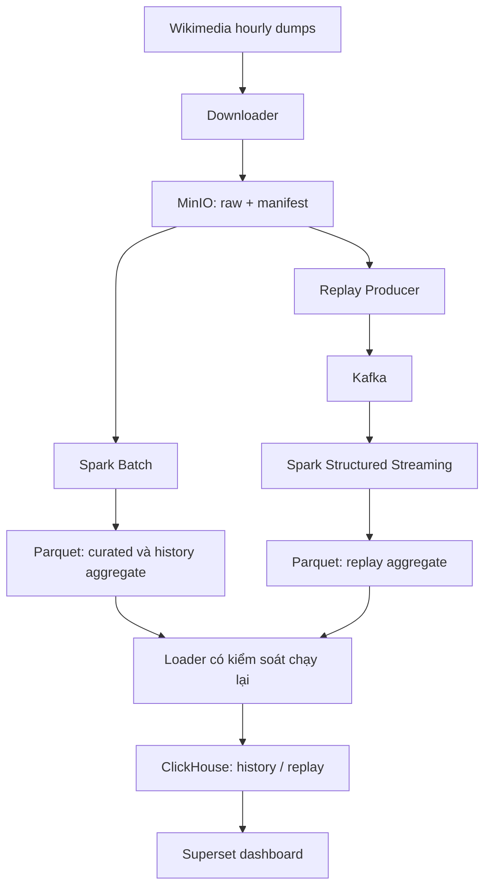

# Wikipedia Attention Observatory

Triển khai DATA: [hợp đồng dữ liệu](docs/data-contract.md), [hướng dẫn chạy](docs/data-role.md) và [tiến độ 15 issue kèm bằng chứng kiểm tra](docs/data-issues-progress.md).

> Big Data Storage and Processing - Project 5 | Nhóm 3 người | Kế hoạch 12 tuần

Phân tích cách mức độ chú ý trên Wikipedia thay đổi theo thời gian bằng dữ liệu pageview theo giờ, đồng thời đánh giá hệ thống batch/stream về tính đúng, tốc độ, khả năng mở rộng và phục hồi sau lỗi.

**Tình trạng:** README mô tả kiến trúc và kế hoạch cập nhật ngày 10/11/2026. Phần DATA hiện có downloader, parser và Spark Batch MVP trong repository; các thành phần hạ tầng, replay/stream, serving và dashboard vẫn theo kế hoạch, cần kiểm chứng trên môi trường nhóm.

- Quản lý công việc: [PRODUCT_BACKLOG.md](./PRODUCT_BACKLOG.md).
- Hướng dẫn chạy phần DATA: [docs/data-role.md](./docs/data-role.md).
- Nguồn yêu cầu: đề Project Topics 2026, Common Requirements và Project 5.
- Nhóm triển khai theo các mốc chạy được, tích hợp sớm và tăng dữ liệu dần.

## 1. Mục tiêu và phạm vi

Câu hỏi chính: **Làm thế nào xử lý pageviews quy mô lớn để phát hiện tăng trưởng nhanh, attention burst, sự chú ý ngắn hạn, kéo dài và lặp lại?**

Phạm vi cốt lõi:

1. Tự động tải hourly dumps, giữ nguyên file nguồn và metadata.
2. Lọc/chuẩn hóa Wikipedia tiếng Anh và tiếng Việt; tạo dữ liệu cột hiệu quả.
3. Spark Batch phân tích lịch sử; Kafka Replay + Spark Structured Streaming xử lý phát lại lịch sử.
4. Aggregate giờ/ngày, attention metric minh bạch và dashboard tương tác.
5. Đủ năm nhóm thí nghiệm: chi tiết vs aggregate, storage layout, batch scale-out, replay rate và failure/recovery.
6. Triển khai cuối trên Kubernetes hoặc cloud. Docker Compose cục bộ chỉ dùng phát triển; không thay yêu cầu triển khai cuối.

ML/AI, Airflow, Recent Changes và hệ monitoring đầy đủ là phần mở rộng. Nhóm ưu tiên tính đúng và thí nghiệm hệ thống trước khi thêm công nghệ.

## 2. Dữ liệu và quy tắc đọc

Nguồn: [Wikimedia hourly pageview dumps](https://dumps.wikimedia.org/other/pageviews/) và [mô tả chính thức](https://wikitech.wikimedia.org/wiki/Analytics/Data/Pageviews).

- Bắt đầu với 1-3 ngày để kiểm tra pipeline. Chọn thêm dữ liệu nền đủ dài trước khi đánh giá attention hoặc mẫu theo tuần.
- Khoảng 1-3 năm là phạm vi tham khảo theo đề, không phải khối lượng đã tải hoặc cam kết cố định.
- Đề khuyến nghị khoảng 20-100 GB dữ liệu xử lý; ghi riêng dung lượng nén gốc, curated, số dòng và phạm vi sau lọc. Chốt dataset bằng phép đo capacity, không chỉ bằng số năm.
- Cùng một manifest đầu vào được dùng cho batch và replay. Báo rõ giờ nguồn thiếu hoặc hỏng; không tự coi giờ thiếu file là 0 views.

**Ý nghĩa bản ghi:** một dòng là pageviews đã tổng hợp theo trang/project trong một giờ, không phải một click cá nhân. Các tổng views phải dùng `SUM(views)`, không dùng số dòng thay số lượt xem.

**Schema nguồn:** giữ `domain_code`, `page_title`, `count_views` và trường thứ tư nếu có. Trường legacy `total_response_size` không phải kích thước nội dung bài viết; thông tin byte đã bị bỏ/không còn đáng tin trong pageviews hiện đại, nên không dùng làm metric chính.

**Thời gian:** chuẩn hóa UTC. Tài liệu nguồn quy định timestamp trong tên file là cuối kỳ tổng hợp; parser phải có fixture qua biên giờ/ngày, định nghĩa rõ `hour_start`/`hour_end` và kiểm chứng trên file mẫu.

**Project:** mã nguồn có thể là `en`, `en.m`, `vi`, `vi.m`; không lọc bằng chuỗi `enwiki`/`viwiki` nếu chưa ánh xạ. Dùng whitelist và giữ `domain_code`/`access_variant` để phân biệt trước khi chủ động cộng desktop/mobile.

## 3. Pipeline

### Nhánh batch

Downloader lưu file nén nguyên gốc vào MinIO. Spark dùng parser chung để chuẩn hóa, tạo curated detail, aggregate và attention output. Dữ liệu lịch sử là kết quả phân tích và là mốc đối chiếu cho replay.

### Nhánh replay

Producer đọc cùng raw snapshot, dùng cùng quy tắc parse/filter và phát theo đồng hồ replay. Kafka chuyển bản ghi cho Spark Structured Streaming; ứng dụng tính kết quả theo **event time lịch sử**, không đổi event time thành thời điểm gửi.

Checkpoint đặt ở storage bền vững, tách khỏi output. Cùng một lần chạy tiếp tục thì dùng lại checkpoint; lần thí nghiệm độc lập phải có `run_id`, output và checkpoint riêng.

MVP ghi Parquet cho các window đã chốt, dùng chế độ Append phù hợp file sink. Cần xác định cách chốt các window cuối khi replay hữu hạn kết thúc và đo riêng độ trễ chốt window. Dashboard phải nói rõ đang hiển thị kết quả đã chốt hay tạm thời. Đường cập nhật tạm thời vào serving chỉ thêm sau khi có quy tắc upsert/retry được kiểm chứng.

### Serving và kiểm chứng

Loader nạp output đã hoàn tất vào ClickHouse. Bảng lịch sử và bảng replay tách riêng; replay có `run_id`, bảng attention có `metric_version`. Dashboard chọn rõ nhánh/lần chạy, không cộng hai kết quả của cùng dữ liệu lịch sử.

Loader phải được thử cả chạy lại và lỗi giữa lúc ghi/đánh dấu hoàn tất. Chốt chiến lược theo partition, deterministic batch hoặc staging/replacement trong tài liệu; không mặc định append hoặc MergeTree tự bảo đảm duy nhất. Checkpoint Spark không tự bảo đảm exactly-once cho mọi sink ngoài.

## 4. Các lớp dữ liệu và hợp đồng chung

| Lớp | Nội dung | Nguyên tắc |
|---|---|---|
| Raw | File nguồn nén và manifest | Giữ nguyên; có source URL, checksum, giờ nguồn, trạng thái tải |
| Curated | Chi tiết đã parse/filter | Có schema version, lineage, quy tắc UTC/project/title |
| History aggregate | Tổng hợp lịch sử | Giờ/ngày, traffic, top pages, attention |
| Replay aggregate | Output streaming | Tách theo run_id; chỉ đối chiếu window cùng phạm vi đã chốt |
| Serving | Bảng ClickHouse | Detail/aggregate/history/replay có khóa và chính sách nạp rõ ràng |
| Checkpoint | Offset/state/progress streaming | Storage bền vững; đường dẫn riêng theo ứng dụng/lần chạy |

Các trường đề xuất để chốt ở PB-007:

| Trường | Ý nghĩa |
|---|---|
| `hour_start`, `hour_end` | Khoảng giờ dữ liệu, UTC |
| `domain_code`, `project`, `access_variant` | Mã nguồn và project chuẩn hóa; biến thể truy cập |
| `page_title`, `views` | Trang và số lượt xem trong kỳ; views dùng kiểu số nguyên đủ lớn |
| `source_file`, `source_line`, `event_id` | Lineage và định danh ổn định từ nguồn |
| `schema_version` | Phiên bản quy tắc parse/schema |
| `run_id`, `produced_at` | Lần replay và thời điểm producer phát; chỉ có ở envelope replay |
| `metric_version` | Phiên bản công thức/ngưỡng attention |

`event_id` ổn định với cùng snapshot và dòng nguồn; định danh trong replay là `(run_id, event_id)`. Khóa aggregate gồm run/dataset, project, trang nếu có, window và phiên bản metric tương ứng. Dòng raw khác nhau được gộp theo quy tắc phân tích, không bị xóa chỉ vì cùng tên trang.

Ba người cùng chốt: schema/envelope, API parser, bảng output, quy tắc missing vs zero, phạm vi mobile/desktop, metric, key và chính sách chạy lại. Bất kỳ thay đổi nào phải cập nhật fixture và người dùng đầu ra.

## 5. Phân công nhóm

Tên vai trò dưới đây thay cho A/B/C cũ để tránh nhầm khi chuyển assignee. Điền tên người thật trên board; mỗi issue chỉ có một owner chính.

| Vai trò | Sở hữu chính | Đầu ra nghiệm thu | Hướng tự đề xuất |
|---|---|---|---|
| DATA - Người 1 | Downloader, parser chung, curated, Spark Batch, attention | Sample tái lập được; bảng detail/aggregate; metric spec và một case burst | Baseline, long-tail, partition layout, xử lý trang ít views |
| STREAM - Người 2 | Replay, topic/key, Structured Streaming, checkpoint, consistency/recovery | Stream khớp batch trên sample; đổi tốc độ; restart và báo thiếu/trùng | Replay scheduling, partition/key, trigger, thử late data |
| PLATFORM - Người 3 | Kubernetes/cloud, MinIO, Spark/Kafka runtime, ClickHouse, loader, Superset | Môi trường tái lập; job nhiều worker; serving/dashboard cho cả hai nhánh | Table/query layout, deployment, dashboard, tài nguyên |

- DATA tự đóng gói/cấu hình job batch; STREAM tự đóng gói/cấu hình producer/stream job. PLATFORM cung cấp hạ tầng và review kết nối/tài nguyên.
- DATA và STREAM cung cấp schema/output mẫu để PLATFORM xây serving sớm; không chờ tới cuối kỳ mới tích hợp.
- Mỗi owner viết phần thí nghiệm/kết quả của mình; cả ba review report, hiểu pipeline và tham gia demo.
- Mỗi người chọn một cải tiến có giả thuyết và phép đo sau khi baseline chạy đúng. Không bắt buộc dùng cùng một giải pháp tối ưu.

## 6. Phân tích và attention metric

Bắt buộc có top pages theo giờ/ngày, traffic ngày/tuần, long-tail, tăng trưởng nhanh, burst duration và phân loại short-lived/sustained/recurring. So sánh tiếng Anh/Việt bằng thống kê có ý nghĩa; hai title khác ngôn ngữ không tự được xem là cùng một chủ đề.

Baseline khởi đầu: so `views` hiện tại với mean/std của các giờ **trước đó** của cùng trang/project:

`score = (current_views - historical_mean) / max(historical_std, epsilon)`

PB-401/PB-402 phải chốt độ dài lịch sử, minimum history/views, epsilon, threshold và xử lý std bằng 0. Không đưa giờ hiện tại hoặc tương lai vào baseline. Có thể so thêm relative growth hoặc baseline theo giờ/ngày trong tuần khi có đủ dữ liệu.

PB-405 định nghĩa bằng tham số: burst bắt đầu/kết thúc, gộp khoảng gián đoạn, short-lived/sustained và các burst lặp lại. Nhãn là quy tắc phân tích có lý giải, chưa phải ground truth. Case study phải có đường views, baseline, score và đoạn burst.

## 7. Năm nhóm thí nghiệm bắt buộc

| Thí nghiệm | Owner | Thiết kế tối thiểu | Bằng chứng |
|---|---|---|---|
| Chi tiết vs aggregate | PLATFORM | Cùng engine, cùng phạm vi/filters và câu hỏi; đối chiếu kết quả. Đổi định dạng/engine thì báo là phép đo khác | Latency lặp lại + median, rows/bytes scanned nếu có, CPU/RAM |
| Storage layout | DATA | Hai layout trên cùng dữ liệu/nội dung và workload | Runtime, số/kích thước file, scan/pruning và small-file effect |
| Batch scale-out | PLATFORM | Cùng input/code/config nền, thay worker counts khả thi; mục tiêu 1/2/4 | Runtime, throughput, speedup, executor placement và tài nguyên |
| Replay rate | STREAM | Nhiều speed factors, định nghĩa 1x rõ; ghi tốc độ thực và thời lượng | Input/processing rate, backlog/lag, latency theo thời gian |
| Failure/recovery | STREAM | Baseline không lỗi; dừng consumer hoặc worker khi đang chạy; restart | Thời điểm lỗi/phục hồi, checkpoint, offset, missing/duplicate và đối chiếu window |

Đo `produced_at -> persisted/visible_at` để đánh giá độ trễ vận hành khi replay lịch sử; không lấy thời gian hiện tại trừ timestamp lịch sử làm processing latency. Ghi rõ mốc dừng đồng hồ.

Mỗi kết quả cần commit, manifest/dataset ID, run_id, cấu hình, máy/node/CPU/RAM, số executor, cache policy và log. Chốt warm-up/lặp lại trước khi đo; chưa đạt saturation thì báo chưa quan sát được, không tự đặt ngưỡng. Nhiều worker cùng một máy phải được mô tả đúng giới hạn, không gọi là bằng chứng scale-out nhiều máy vật lý.

## 8. Công nghệ và các quyết định cần chốt

| Thành phần | Baseline đề xuất |
|---|---|
| Ingestion/replay | Python, downloader và replay tách module |
| Raw storage | MinIO/S3-compatible |
| Curated/output | Parquet trước; Iceberg khi có nhu cầu rõ về table/snapshot/schema |
| Batch/stream | Apache Spark và Structured Streaming |
| Message broker | Apache Kafka |
| Serving/dashboard | ClickHouse và Apache Superset |
| Triển khai cuối | Kubernetes hoặc cloud |

Pin phiên bản dependency/image sau smoke test chung; không dùng tag `latest` trong cấu hình tái lập. Không có yêu cầu thêm MongoDB, Presto hay HDFS chỉ vì HW3 đã dùng chúng.

## 9. Các mốc triển khai

| Mốc | Khoảng tuần tham khảo | Hoàn thành khi |
|---|---|---|
| M0 - Contracts và sample | W1-W2 | Manifest mẫu, parser fixture, schema/output contract và kế hoạch benchmark |
| M1 - Batch xuyên suốt | W3-W5 | Raw trên MinIO -> Spark -> Parquet -> ClickHouse -> một biểu đồ; local trước rồi kiểm chứng trên môi trường cuối |
| M2 - Hai nhánh đúng | W5-W8 | Batch analytics/attention; replay/stream; checkpoint; loader chạy lại; bảng so khớp và dashboard chọn run |
| M3 - Tăng quy mô | W9-W10 | Dataset cuối, ba benchmark layout/query/worker và replay rate có số đo |
| M4 - Recovery và bàn giao | W11-W12 | Fault experiment, diễn giải semantics, report và demo tái lập |

STREAM nghiên cứu/prototype từ W2-W3 với sample; PLATFORM dựng ClickHouse/chart mẫu từ W3-W4. Không đợi batch hoàn chỉnh hoặc tới W8-W9 mới bắt đầu toàn bộ phần của hai người này. Các tuần là mốc tương đối, không xác nhận tiến độ hiện tại.

## 10. Cấu trúc repository và tài liệu cần bổ sung

Giữ cấu trúc thư mục hiện có. Bảng sau là nơi đặt các phần tương ứng; không có nghĩa mọi file đã tồn tại.

| Đường dẫn | Nội dung |
|---|---|
| `docs/` | Architecture, data model, attention metric, experiment protocol, decisions, setup |
| `infra/` | Kubernetes/cloud manifests; MinIO, Kafka, Spark, ClickHouse, Superset |
| `ingestion/downloader/`, `ingestion/replay/` | Tải nguồn và producer |
| `processing/common/` | Parser, schema, normalization, identity dùng chung |
| `processing/batch/`, `processing/streaming/` | Các ứng dụng Spark |
| `sql/ddl/`, `sql/analytics/`, `sql/experiments/` | Schema serving, truy vấn và benchmark |
| `dashboard/` | Dashboard exports, cấu hình tái lập không chứa secret |
| `experiments/` | Kịch bản benchmark, fault injection và chạy thí nghiệm |
| `tests/` | Fixture nhỏ, kiểm tra semantics và integration có giá trị |
| `scripts/`, `config/` | Entry points, cấu hình mẫu và tham số |
| `reports/results/` | Manifest run, bảng số đo, log/ảnh chọn lọc và báo cáo |

Chưa đưa lệnh setup chưa triển khai vào README như thể đã chạy được. PB-902 bổ sung lệnh thực tế cho setup, download, batch, replay, load, dashboard, reset và recovery sau smoke test trên môi trường nhóm. Không commit dump lớn hoặc secrets; ghi nơi lưu và cách tái tạo.

## 11. Definition of Done

- [ ] Ingestion tái lập, raw/manifest và data quality report.
- [ ] Hợp đồng schema/time/project được cả ba nhánh sử dụng thống nhất.
- [ ] Batch và stream tạo aggregate đúng; đối chiếu số views, keys/windows và missing/duplicate.
- [ ] Attention spec và một historical burst, cùng phân loại attention có lý giải.
- [ ] ClickHouse loader có quy tắc retry được thử; dashboard history/replay không cộng trùng.
- [ ] Triển khai Kubernetes/cloud, có bằng chứng job phân tán theo cấu hình đã công bố.
- [ ] Đủ năm nhóm thí nghiệm, số liệu/log và diễn giải giới hạn.
- [ ] Setup và demo được một thành viên khác làm lại từ hướng dẫn.
- [ ] Report, slide/demo và vai trò từng người được cả nhóm kiểm tra.

## 12. Tài liệu tham khảo

- Đề Project Topics 2026, trang 2 và 11-12 do học phần cung cấp.
- [Wikimedia Pageviews](https://wikitech.wikimedia.org/wiki/Analytics/Data/Pageviews).
- [Spark Structured Streaming: sources, sinks, checkpoint và recovery](https://spark.apache.org/docs/3.5.6/structured-streaming-programming-guide.html).
- [Product Backlog và quy ước issue](./PRODUCT_BACKLOG.md).
