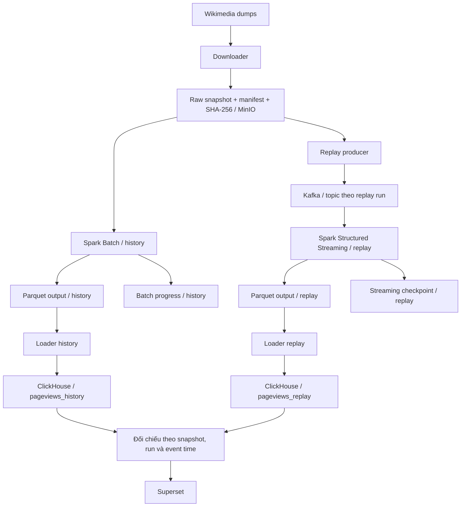

# PB-005 — Architecture v1 và ranh giới hai nhánh

Trạng thái: đã có thiết kế và bản kiểm chứng local; chờ PB-007 được ký nhận và
review bởi một thành viên khác. Tài liệu này không xác nhận triển khai phân tán.

## 1. Quyết định kiến trúc

Một downloader lưu nguyên byte các dump vào một raw snapshot bất biến. Batch
và replay cùng đọc danh sách file trong manifest của snapshot đó. Replay không
tải lại dữ liệu từ Wikimedia. Output hai nhánh không ghi chung đường dẫn/bảng.

Parquet là baseline v1; Iceberg là mở rộng sau. Bản local dùng JSON/SQLite để
kiểm chứng ranh giới, không thay thế triển khai Spark/Kafka/MinIO/ClickHouse.

## 2. Định danh và vị trí lưu

Nguồn cấu hình: [`config/architecture.json`](../config/architecture.json).

| Thành phần | Địa chỉ logic |
|---|---|
| Raw, dùng chung | `s3://wao/raw/snapshots/{snapshot_id}/` |
| Manifest | `<raw>/manifest.json` |
| History output | `s3://wao/outputs/history/{snapshot_id}/{run_id}/` |
| Replay output | `s3://wao/outputs/replay/{snapshot_id}/{run_id}/` |
| Batch progress | `s3://wao/checkpoints/history/{snapshot_id}/{run_id}/` |
| Streaming checkpoint | `s3://wao/checkpoints/replay/{snapshot_id}/{run_id}/` |
| Kafka topic dự kiến | `pageviews.replay.{run_id}` |
| Serving | `pageviews_history`, `pageviews_replay` |

- Manifest phải liệt kê tên file, checksum SHA-256 và giờ dữ liệu UTC; chỉ công bố
  snapshot sau khi đủ file và kiểm tra checksum. Không sửa file của snapshot đã
  công bố. Sửa dataset tạo snapshot mới; từ chối xử lý nếu checksum sai.
- `snapshot_id` nhận diện bộ raw cố định. `run_id` nhận diện một lần chạy của một
  nhánh; lần chạy độc lập dùng ID mới. Resume dùng lại ID cũ và đúng cấu hình.
- So sánh hai nhánh bằng cặp history run/replay run được chọn rõ ràng và cùng
  snapshot/contract; không yêu cầu hai nhánh có cùng `run_id`.
- Streaming checkpoint thuộc đúng query/run/schema/config; không tái sử dụng
  khi đổi query, schema, topic hoặc snapshot. Không xóa checkpoint để mô phỏng
  resume. Batch progress là sổ tiến độ riêng, không phải Spark streaming state.
- Giữ `event_time` gốc khi replay. Thời gian phát/nhận chỉ phục vụ latency;
  không thay thế giờ dữ liệu trong cửa sổ phân tích.

## 3. Ranh giới thư mục và trách nhiệm

| Thư mục | Trách nhiệm | Vai trò |
|---|---|---|
| `infra/` | Triển khai, bucket, Kafka, Spark, ClickHouse, quyền truy cập | PLATFORM |
| `config/` | Namespace và cấu hình chạy; không chứa secret | PLATFORM, DATA, STREAM |
| `ingestion/` | Downloader, publish manifest, replay producer đọc snapshot | DATA, STREAM |
| `processing/` | Batch và streaming; dùng parser/schema chung do PB-007 cung cấp | DATA, STREAM |
| `storage/` | Quy ước layout, partition và metadata lưu trữ | DATA, PLATFORM |
| `serving/` | Loader history/replay, DDL và truy vấn đối chiếu | ANALYTICS, DATA |
| `dashboard/` | Dashboard chọn rõ history/replay và run | ANALYTICS |
| `tests/fixtures/` | Fixture nhỏ, tổng hợp, được commit để tái lập | DATA |
| `scripts/` | Lệnh kiểm chứng và vận hành | PLATFORM |
| `reports/` | Bằng chứng chạy, kết quả và review | Nhóm |
| `docs/` | Kiến trúc, contract và hướng dẫn | Nhóm |

Các module production nêu trên là ranh giới triển khai tiếp theo; hiện chưa có
job Spark, producer Kafka hay loader ClickHouse trong repo. Không tạo thư mục
rỗng để coi như đã triển khai thành phần.

## 4. Contract và phụ thuộc PB-007

PB-007 do DATA sở hữu và STREAM/PLATFORM ký nhận: schema/envelope version,
`event_id`, `run_id`, quy tắc time/project/title, output contract và fixture.
PB-005 tham chiếu và bố trí contract vào pipeline, không tự ký nhận PB-007.

Bản kiểm chứng dùng **`pb007-draft-v1`**, chưa phải contract được duyệt:

| Trường | Quy ước tạm dùng trong fixture |
|---|---|
| `schema_version` | `pb007-draft-v1` |
| `event_id` | SHA-256 của `snapshot_id + LF + source_filename + LF + line_number` (1-based) |
| `snapshot_id`, `run_id` | Snapshot nguồn và lần chạy hiện tại |
| `event_time` | UTC ISO-8601, lấy từ metadata file giờ trong manifest |
| `project` | Giữ mã raw `en`/`vi`; không tự đổi thành `enwiki`/`viwiki` |
| `page_title` | Giữ nguyên token raw UTF-8, không URL-decode hoặc đổi dấu gạch dưới |
| `views`, `content_size` | Số nguyên từ fixture |
| `branch` | `history` hoặc `replay` |

Identity tạm là identity của bản ghi nguồn, ổn định giữa hai nhánh và các run
trên cùng snapshot; không tuyên bố khử trùng xuyên snapshot. Khi PB-007 chốt,
cập nhật config, fixture, proof và loader đồng bộ, chạy lại bằng run mới.

## 5. Loader và bảng history/replay

Mỗi loader chỉ đọc output đã hoàn thành của nhánh mình và kiểm tra version,
snapshot/run và trạng thái hoàn tất trước khi publish. Không cho dashboard đọc
run đang nạp dở. Bản production cần completion marker và trạng thái publish run.

Hai bảng có cùng schema contract nhưng tách vật lý. Với output bản ghi nguồn,
khóa logic là `(run_id, event_id)` trong từng bảng. Loader chạy lại cùng output
phải cho cùng kết quả; run mới được lưu độc lập và truy vấn phải lọc run.
Với aggregate, PB-007 cần chốt khóa theo run/window/project/page/metric; không
áp dụng máy móc identity của raw record cho aggregate.

Ví dụ reference loader trong `scripts/verify_pb005.py` dùng SQLite primary key
và upsert trong transaction. ClickHouse production cần thiết kế riêng: staging
theo run, kiểm tra count/checksum rồi publish/thay thế phần dữ liệu của run theo
cơ chế được chọn. Không coi INSERT ClickHouse mặc định là idempotent hoặc coi
ReplacingMergeTree tự bảo đảm truy vấn không trùng ngay lập tức.

Đối chiếu history/replay phải kiểm tra tập khóa, số record, tổng views và giá trị
theo event/window trên cùng snapshot và contract. Dashboard chọn một nhánh/run,
không UNION rồi SUM hai bản sao của cùng dữ liệu.

## 6. Bằng chứng và điều kiện hoàn tất

Lệnh chạy, kết quả và checklist review nằm trong
[`reports/pb005/evidence.md`](../reports/pb005/evidence.md).
Proof local kiểm tra: raw checksum, namespace tách biệt, output bằng nhau,
replay dừng/tiếp tục không mất hoặc trùng bản ghi, checkpoint history không bị
đổi, identity ổn định qua run và nạp lại hai bảng không tăng số dòng/tổng views.

Để đóng issue cần thêm PB-007 đã được DATA/STREAM/PLATFORM thống nhất và một
thành viên khác review PR. Log local không thay thế chữ ký hoặc review đó.
